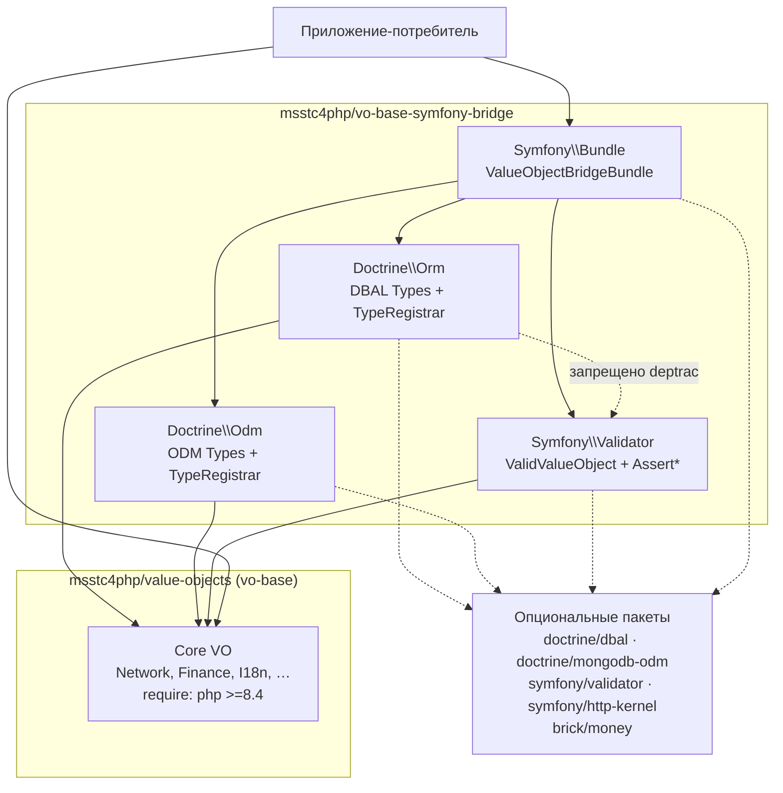
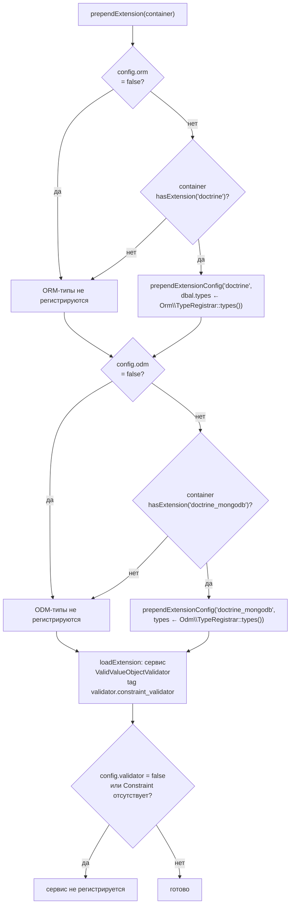

# refactor: Вынести фреймворк-мосты из vo-base в отдельный пакет

**Целевые репозитории:** два.
- `vo-base-symfony-bridge` — новый репозиторий (документ живёт здесь). Пути без префикса относятся к нему.
- `vo-base` — донор. Его пути помечены префиксом `vo-base:`.

---

## Summary

`vo-base` сейчас содержит три фреймворк-моста (Symfony Validator, Doctrine ORM, Doctrine MongoDB ODM) внутри `src/Bridge/`. Они не нарушают инвариант «ядро без рантайм-зависимостей» — deptrac запрещает Core → Bridge, а фреймворки лежат в `require-dev` + `suggest`. Но сам факт их присутствия означает, что репозиторий ядра знает про Doctrine и Symfony: тянет их в dev, гоняет CI с расширением `mongodb`, документирует их в README и внутренних доках.

План выносит все три моста в самостоятельный composer-пакет `msstc4php/vo-base-symfony-bridge` под новым корневым namespace `MSSTC4PHP\ValueObjectBridge\`, добавляет к ним Symfony Bundle с авторегистрацией DBAL/ODM-типов и валидатора, и зачищает `vo-base` до состояния «в исходниках, зависимостях, CI и документации нет ни одного упоминания фреймворка».

Перенос самих мостов — чистая релокация: поведение классов не меняется, меняются только `namespace`/`use`. Единственный новый код — Bundle.

---

## Problem Frame

**Что не так сейчас.** Ядро и мосты живут в одном релизном цикле. Практические следствия:

- Любой апгрейд Doctrine или Symfony заставляет двигать репозиторий ядра, хотя ядро к ним не притрагивается.
- CI ядра обязан ставить `intl`, `mongodb`, `bcmath` и весь Doctrine-стек, чтобы прогнать `make check` — это цена, которую платит каждый прогон.
- Потребитель, которому нужны только value objects, всё равно читает README, наполовину состоящий из инструкций по Doctrine.
- Инвариант autoload-безопасности («bridge-классы фатально падают без фреймворка, поэтому Core не смеет их трогать») держится на deptrac-правиле и дисциплине. Физическое разделение пакетов делает его структурным.

**Что хотим получить.** Ядро — библиотека на PHP без единого фреймворк-упоминания. Мосты — отдельный пакет, который зависит от ядра как обычный потребитель, и который можно версионировать и выкладывать независимо.

**Чего этот план не решает.** Публикация обоих пакетов на Packagist, теги релизов, миграционные гайды для внешних потребителей — вне объёма (потребителей за пределами этих двух репозиториев пока нет).

---

## Requirements

| ID | Требование |
|---|---|
| R1 | Все файлы `vo-base: src/Bridge/**` и `vo-base: tests/Bridge/**` присутствуют в новом репозитории и удалены из `vo-base`. |
| R2 | Перенесённые классы живут под корневым namespace `MSSTC4PHP\ValueObjectBridge\`; сегмент `Bridge` из пути namespace исчезает (он теперь выражен именем пакета). |
| R3 | Перенос не меняет поведение: тело каждого перенесённого класса и теста побайтово совпадает с оригиналом за вычетом строк `namespace` и `use`. |
| R4 | Новый пакет требует в рантайме только `php >=8.4` и `msstc4php/value-objects`. Doctrine, Symfony и `brick/money` остаются опциональными (`require-dev` + `suggest`). |
| R5 | Symfony Bundle регистрирует DBAL-типы, ODM-типы и валидатор констрейнта автоматически, каждую группу — только когда соответствующее расширение контейнера реально присутствует. |
| R6 | Поведение Bundle управляемо конфигурацией: каждую из трёх групп можно принудительно включить или выключить. |
| R7 | Новый репозиторий несёт свой комплект тулинга уровня `vo-base` (PHPStan level 9, cs-fixer, Rector, deptrac, PHPUnit, Makefile) и CI. |
| R8 | CI нового репозитория доказывает autoload-безопасность: Doctrine-мосты грузятся без установленного Symfony и наоборот. |
| R9 | deptrac нового репозитория запрещает перекрёстные зависимости между Doctrine- и Symfony-слоями. |
| R10 | После зачистки `vo-base` в его `composer.json` (require и require-dev), CI-конфигах, README и `.claude/docs` нет упоминаний Doctrine и Symfony Validator. |
| R11 | `vo-base` сохраняет машинный запрет на возврат фреймворков в ядро (deptrac-правило, а не только договорённость). |
| R12 | Работа в `vo-base` останавливается на изменённом рабочем дереве — коммиты там делает владелец репозитория вручную. |

---

## Key Technical Decisions

### KTD1 — Новый корневой namespace, без слоя совместимости

`MSSTC4PHP\ValueObject\Bridge\Doctrine\Orm\EmailAddressType` → `MSSTC4PHP\ValueObjectBridge\Doctrine\Orm\EmailAddressType`.

Почему без alias-прослойки: внешних потребителей нет (в `vo-base` нет ни одного тега, ветка `feat/value-objects-library`), а два пакета, делящих один PSR-4 префикс, — постоянный источник путаницы в autoload-мапе и в поиске по коду. Ломающее изменение стоит дёшево именно сейчас.

Следствие: имена типов в БД (`vo_email_address`, …) **не меняются** — это строковые константы `NAME`, они не привязаны к namespace. Существующие маппинги сущностей продолжают работать, если потребитель поменяет только FQCN в `doctrine.dbal.types` (а с Bundle — и этого не потребуется).

### KTD2 — Все фреймворки остаются опциональными

Пакет называется «symfony-bridge», но содержит и Doctrine-мосты, работающие на голом Doctrine без Symfony. Поэтому в `require` не попадает ни `symfony/validator`, ни `doctrine/orm`: тот же приём, что в `vo-base` — `require-dev` для тестов + `suggest` для потребителя.

Инвариант autoload-безопасности сохраняется в новой форме: **Doctrine-ветка не смеет ссылаться на Symfony-ветку и наоборот**; на обе может ссылаться только Bundle, который сам по себе фатален без `symfony/http-kernel` и потому грузится исключительно из `bundles.php`. Правило машинное (R9, deptrac).

### KTD3 — Bundle на `AbstractBundle`, регистрация типов через `prepend`

Symfony 6.1+ `AbstractBundle` даёт один класс вместо связки Bundle + Extension + Configuration. DBAL- и ODM-типы регистрируются не вызовом `TypeRegistrar::registerAll()` на буте, а `prependExtensionConfig()` в конфиг `doctrine` / `doctrine_mongodb` — это канонический для Symfony способ: типы попадают в скомпилированный контейнер, работают с прогретым кэшем и с `doctrine:schema` командами, и потребитель может их переопределить в своём `config/packages/`.

Источник истины для списка — существующие `TypeRegistrar::types()` обоих мостов. Bundle их не дублирует, а вызывает.

`ValidValueObjectValidator` регистрируется сервисом с тегом `validator.constraint_validator`. Строго говоря, он и без этого работает (конструктор без аргументов, `ContainerConstraintValidatorFactory` падает в `new`), но явная регистрация делает поведение предсказуемым и даёт точку расширения.

### KTD4 — Определение доступности через `hasExtension`, не через `class_exists`

Prepend-ветка для ORM выполняется, если контейнер знает расширение `doctrine`; для ODM — `doctrine_mongodb`. Проверка `class_exists(Type::class)` здесь неверна: DBAL может лежать в vendor транзитивно, без DoctrineBundle, и тогда `prependExtensionConfig('doctrine', …)` упадёт на несуществующем расширении.

### KTD5 — Разрешение зависимости на `vo-base` до его публикации

`msstc4php/value-objects` не опубликован (нет тегов). Пока это так, `composer.json` нового пакета несёт `repositories` c VCS-записью на `git@github.com:msstc4php/vo-base.git` и требует ветку-разработку. Это временная конструкция: как только `vo-base` получит тег, запись удаляется, а constraint становится `^1.1`. Помечено в Open Questions как решение владельца.

### KTD6 — `symfony/intl` остаётся в `vo-base`

Он используется только генератором `vo-base: tools/generate-iso-enums.php` и тестом актуальности сгенерированных энамов. Это источник данных ISO, а не фреймворк: сгенерированные энамы закоммичены, рантайм-зависимости от него нет. Удаление сломало бы проверку актуальности ради буквальности формулировки. Решение фиксируется в доках `vo-base`, чтобы не переоткрывать вопрос.

### KTD7 — В `vo-base` deptrac остаётся, но меняет назначение

Слой `Bridge` исчезает вместе с директорией. Вместо снятия deptrac конфиг переписывается на запрет обратного направления: слой, собранный по regex имён классов `^(Doctrine|Symfony)\\`, объявляется запрещённым для ядра. Так «ядро не знает про фреймворки» становится проверкой в `make check`, а не комментарием в README (R11).

---

## High-Level Technical Design

### Форма зависимостей после переноса



Сплошные стрелки — жёсткие зависимости кода, пунктир — опциональные пакеты, которые обязан поставить потребитель. Горизонтальная связь Doctrine ↔ Symfony отсутствует по построению и проверяется deptrac (R9).

### Решения Bundle при сборке контейнера



Схема — направляющая для проверяющего; авторитетен текст плана и итоговый код.

---

## Output Structure

```
vo-base-symfony-bridge/
├── composer.json
├── Makefile
├── README.md
├── LICENSE
├── .gitignore
├── deptrac.yaml
├── phpunit.xml.dist
├── phpstan.dist.neon
├── phpstan-ci.neon
├── phpstan-baseline.neon
├── rector.php
├── .php-cs-fixer.dist.php
├── .github/workflows/ci.yml
├── .gitlab-ci.yml
├── .claude/docs/
│   ├── README.md
│   ├── architecture.md
│   ├── integrations.md
│   ├── conventions.md
│   └── known-issues.md
├── docs/plans/
├── src/
│   ├── Doctrine/
│   │   ├── Orm/          # 34 файла: Abstract*VoType, *Type, TypeRegistrar
│   │   └── Odm/          # 33 файла
│   └── Symfony/
│       ├── Validator/    # 15 файлов: ValidValueObject(+Validator), Assert*
│       └── Bundle/
│           └── ValueObjectBridgeBundle.php
└── tests/
    ├── Doctrine/Orm/     # 3 файла
    ├── Doctrine/Odm/     # 3 файла
    ├── Symfony/Validator/# 4 файла
    └── Symfony/Bundle/   # новые тесты Bundle
```

Дерево — декларация ожидаемой формы, а не ограничение. Авторитетны списки `**Файлы:**` в юнитах.

---

## Implementation Units

### U1. Бутстрап репозитория и разрешение зависимости на ядро

**Цель.** Пустой каталог превращается в устанавливаемый composer-пакет, чей автозагрузчик видит классы ядра.

**Требования.** R4, KTD5.

**Зависимости.** —

**Файлы.**
- `composer.json` (создать)
- `.gitignore` (создать; взять за основу `vo-base: .gitignore`, выбросив блок про `tools/`)
- `LICENSE` (создать; MIT, как в `vo-base`)
- `README.md` (создать заглушку — наполняется в U9)

**Подход.**
- `name: msstc4php/vo-base-symfony-bridge`, `type: library`, `license: MIT`.
- `require`: `php: >=8.4`, `msstc4php/value-objects`.
- `require-dev`: весь опциональный фреймворк-стек (`doctrine/dbal`, `doctrine/orm`, `doctrine/mongodb-odm`, `doctrine/doctrine-bundle`, `symfony/validator`, `symfony/http-kernel`, `symfony/dependency-injection`, `symfony/config`, `symfony/framework-bundle`, `brick/money`, `brick/math`) плюс тулинг, перенесённый из `vo-base: composer.json` (phpstan + расширения doctrine/symfony/phpunit/strict-rules, php-cs-fixer, rector, deptrac, phpunit, roave/security-advisories). `symfony/intl` и `phpstan-beberlei-assert` не переносить — здесь они не нужны.
- `suggest`: те же формулировки, что в `vo-base: composer.json`, плюс запись про `symfony/http-kernel` для Bundle.
- `autoload`: PSR-4 `MSSTC4PHP\ValueObjectBridge\ → src/`; `autoload-dev`: `MSSTC4PHP\ValueObjectBridge\Tests\ → tests/`.
- `config`: `sort-packages`, `allow-plugins` для phpstan/infection-extension-installer.
- Зависимость на ядро — по KTD5: временная `repositories` запись типа `vcs` + constraint на ветку разработки. Строку пометить комментарием-задачей на снятие после первого тега `vo-base`.
- `git init` в корне; коммит не делать до U9 (см. Verification).

**Паттерны.** `vo-base: composer.json` — форма секций, порядок ключей, `config`.

**Test expectation: none** — инфраструктурный юнит, поведения нет.

**Verification.** `composer validate --strict --no-check-publish` проходит; `composer install` успешен; однострочник `php -r "require 'vendor/autoload.php'; …\Network\Ipv4Address::isValid('1.2.3.4');"` возвращает 0.

---

### U2. Комплект статического анализа и тестового прогона

**Цель.** `make check` и `make test` существуют и зелены на пустом `src/`, чтобы каждый последующий перенос сразу проверялся.

**Требования.** R7, R9.

**Зависимости.** U1.

**Файлы.**
- `phpstan.dist.neon`, `phpstan-ci.neon`, `phpstan-baseline.neon` (создать)
- `.php-cs-fixer.dist.php` (создать)
- `rector.php` (создать)
- `deptrac.yaml` (создать)
- `phpunit.xml.dist` (создать)
- `Makefile` (создать)

**Подход.**
- PHPStan: копия `vo-base: phpstan.dist.neon` (level 9, `phpVersion: 80400`, `treatPhpDocTypesAsCertain: false`, параллелизм), пути `src/` + `tests/`. Baseline создать пустым — новый код должен быть чистым без исключений. `phpstan-ci.neon` — та же обвязка с `reportUnmatchedIgnoredErrors: false` для случая, когда опциональная зависимость отсутствует в конкретной установке.
- cs-fixer и Rector: копии из `vo-base`, из finder убрать `tools/`, из Rector-skip — три записи про сгенерированные ISO-энамы (их здесь нет). Остальные skip-правила сохранить, чтобы стиль двух репозиториев не разъезжался.
- deptrac: слои `DoctrineOrm`, `DoctrineOdm`, `SymfonyValidator`, `SymfonyBundle` по директориям. Ruleset: три первых слоя — без исходящих зависимостей друг на друга (пусто); `SymfonyBundle` → все три. Это машинная форма R9 и KTD2.
- PHPUnit: testsuites `Doctrine`, `Symfony`, `Bundle`; `source.include` — `src/`; остальные строгие флаги (`failOnRisky`, `failOnWarning`, `beStrictAboutOutputDuringTests`) скопировать из `vo-base: phpunit.xml.dist`.
- Makefile: цели `check`, `test`, `test-with-coverage`, `fix`, `regenerate-baseline`, `help` — по образцу `vo-base: Makefile`. Цель `infection` не переносить (см. Scope Boundaries).

**Паттерны.** Одноимённые файлы в `vo-base` — построчно.

**Test expectation: none** — конфигурация тулинга.

**Verification.** `make check` завершается успешно на пустом `src/`; `vendor/bin/deptrac analyse` печатает нулевые нарушения.

---

### U3. Перенос моста Doctrine ORM

**Цель.** 34 класса ORM-моста и их тесты живут в новом репозитории под новым namespace, поведение не изменилось.

**Требования.** R1, R2, R3.

**Зависимости.** U1, U2.

**Файлы.**
- `src/Doctrine/Orm/` — 34 файла из `vo-base: src/Bridge/Doctrine/Orm/`: `AbstractStringVoType.php`, `AbstractTextVoType.php`, `TypeRegistrar.php` и 31 конкретный `*Type.php`.
- `tests/Doctrine/Orm/AllTypesRoundTripTest.php`, `tests/Doctrine/Orm/TypeRegistrarTest.php`, `tests/Doctrine/Orm/TypeRoundTripTest.php` — из `vo-base: tests/Bridge/Doctrine/Orm/`.

**Подход.**
- Копировать файлы как есть. Единственные допустимые правки: строка `namespace` (`MSSTC4PHP\ValueObject\Bridge\Doctrine\Orm` → `MSSTC4PHP\ValueObjectBridge\Doctrine\Orm`, для тестов `…\Tests\Bridge\…` → `MSSTC4PHP\ValueObjectBridge\Tests\Doctrine\Orm`) и `use`-импорты, указывающие на перенесённые классы. Импорты классов ядра (`MSSTC4PHP\ValueObject\Contract\StringConvertible`, конкретные VO) остаются без изменений — ядро свой namespace не меняет.
- Ничего не «улучшать» по дороге: `getName()`/`requiresSQLCommentHint()` отсутствуют намеренно (DBAL 4), `AbstractTextVoType` намеренно отдельный от `AbstractStringVoType`, `GeoCoordinatesType` намеренно однколоночный JSON, а не embeddable.

**Execution note.** Перенос верифицируется диффом: после правки namespace `diff <(sed '/^namespace\|^use /d' исходник) <(sed '/^namespace\|^use /d' копия)` должен быть пустым для каждого файла. Расхождение — дефект переноса, а не улучшение.

**Паттерны.** `vo-base: .claude/docs/integrations.md`, раздел Doctrine ORM — фиксирует, почему код выглядит именно так.

**Test scenarios.** Переносятся существующие; после переноса они обязаны проходить без правок логики.
- Round-trip каждого зарегистрированного типа: `convertToDatabaseValue(VO) → строка → convertToPHPValue → VO`, равный исходному, на `SQLitePlatform`.
- `null` на входе обоих конвертеров возвращает `null`, без обращения к VO.
- `convertToDatabaseValue` с объектом, не реализующим `StringConvertible`, бросает `InvalidArgumentException` с именем ожидаемого интерфейса в сообщении.
- `convertToPHPValue` с не-строкой (int, array) бросает `InvalidArgumentException`.
- `TypeRegistrar::registerAll()` вызванный дважды не бросает — идемпотентность через `Type::hasType`.
- `TypeRegistrar::types()` возвращает карту, ключи которой равны константам `NAME` соответствующих типов, а значения — существующие класс-строки.
- `PortType` отдаёт целочисленную колонку, а не VARCHAR.
- `GeoCoordinatesType` и `DateRangeType` кладут одну JSON-колонку и восстанавливают составной VO.
- `AbstractTextVoType` (Base64String, JsonString) объявляет CLOB, а не VARCHAR(255).
- `BrickMoneyType`round-trip `Brick\Money\Money` через формат `"CUR amount"`.

**Verification.** `vendor/bin/phpunit --testsuite=Doctrine` зелёный; `make check` зелёный; дифф-сверка из Execution note пуста по всем 37 файлам.

---

### U4. Перенос моста Doctrine MongoDB ODM

**Цель.** То же для ODM-ветки — 33 класса и 3 теста.

**Требования.** R1, R2, R3.

**Зависимости.** U1, U2.

**Файлы.**
- `src/Doctrine/Odm/` — 33 файла из `vo-base: src/Bridge/Doctrine/Odm/`.
- `tests/Doctrine/Odm/AllTypesRoundTripTest.php`, `tests/Doctrine/Odm/TypeRegistrarTest.php`, `tests/Doctrine/Odm/TypeRoundTripTest.php`.

**Подход.** Идентичен U3, с поправкой на отличия ODM, которые надо сохранить в неприкосновенности: конвертеры без аргумента `$platform`, отсутствие `getSQLDeclaration`, `use ClosureToPHP` в каждом типе, `GeoCoordinatesType` как встроенный под-документ `['lat' => …, 'lng' => …]`, регистрация через `Type::registerType` под защитой `Type::hasType` (сам `registerType` перезаписывает молча — в этом и причина защиты).

**Execution note.** Та же дифф-сверка, что в U3.

**Паттерны.** `vo-base: .claude/docs/integrations.md`, раздел Doctrine MongoDB ODM.

**Test scenarios.** Переносятся существующие.
- Round-trip каждого зарегистрированного ODM-типа без аргумента платформы.
- `null` проходит насквозь в обе стороны.
- Не-`StringConvertible` на записи → `InvalidArgumentException`; не-строка на чтении → `InvalidArgumentException`.
- `registerAll()` дважды подряд не перезаписывает уже зарегистрированный тип (в отличие от голого `Type::registerType`).
- `GeoCoordinatesType` пишет массив с ключами `lat`/`lng`, а не JSON-строку.
- Набор имён в ODM-реестре совпадает с ORM-реестром один в один (по 31 записи), а значения указывают на ODM-классы — реестры не разъехались при переносе.
- У ODM нет аналога `AbstractTextVoType`: `Base64StringType` и `JsonStringType` наследуют строковую базу напрямую (в BSON нет различия VARCHAR/CLOB). Тест фиксирует, что оба типа round-trip'ят длинное значение без усечения.

**Verification.** `vendor/bin/phpunit --testsuite=Doctrine` зелёный на обеих подпапках; дифф-сверка пуста по всем 36 файлам. Расширение `mongodb` требуется в окружении прогона.

---

### U5. Перенос моста Symfony Validator

**Цель.** 15 классов констрейнтов и 4 теста переезжают без изменения поведения.

**Требования.** R1, R2, R3.

**Зависимости.** U1, U2.

**Файлы.**
- `src/Symfony/Validator/` — 15 файлов из `vo-base: src/Bridge/Symfony/Validator/`: `ValidValueObject.php`, `ValidValueObjectValidator.php` и 13 `Assert*.php`.
- `tests/Symfony/Validator/AssertConstraintsTest.php`, `AssertEmailAddressTest.php`, `AssertIpv4Test.php`, `ValidValueObjectValidatorTest.php`.

**Подход.** Копия с правкой namespace. Два свойства сохранить осознанно: `ValidValueObject` остаётся **не-final** (от него наследуются `Assert*`), `ValidValueObjectValidator` остаётся **без аргументов конструктора** (иначе он перестанет создаваться дефолтной фабрикой в standalone-режиме `Validation::createValidator()`).

**Execution note.** Та же дифф-сверка, что в U3.

**Паттерны.** `vo-base: .claude/docs/integrations.md`, раздел Symfony Validator.

**Test scenarios.** Переносятся существующие.
- Валидная строка для каждого из 13 `Assert*` не даёт нарушений; невалидная даёт ровно одно.
- Сообщение нарушения содержит подставленные `{{ value }}` и `{{ type }}`.
- Кастомное `$message`, переданное в `ValidValueObject`, вытесняет дефолтное.
- `null` и `''` пропускаются без нарушения (пустота — забота `NotBlank`/`NotNull`).
- Не-строка (int, array, object) на входе валидатора бросает `UnexpectedValueException`.
- Констрейнт чужого типа, поданный в `validate()`, бросает `UnexpectedTypeException`.
- Валидатор работает под standalone `Validation::createValidator()` без DI-контейнера.
- Правило валидации не продублировано: провал `Assert*` наступает ровно тогда, когда `от VO from()` бросает `InvalidValueObjectException`.

**Verification.** `vendor/bin/phpunit --testsuite=Symfony` зелёный; дифф-сверка пуста по всем 19 файлам.

---

### U6. Symfony Bundle: авторегистрация типов и валидатора

**Цель.** Потребителю на Symfony достаточно включить бандл в `bundles.php` — DBAL-типы, ODM-типы и валидатор констрейнта регистрируются сами. Это единственный юнит с новым кодом.

**Требования.** R5, R6, KTD3, KTD4.

**Зависимости.** U3, U4, U5.

**Файлы.**
- `src/Symfony/Bundle/ValueObjectBridgeBundle.php` (создать)
- `tests/Symfony/Bundle/ValueObjectBridgeBundleTest.php` (создать)
- `tests/Symfony/Bundle/BundleIntegrationTest.php` (создать)

**Подход.**
- Один класс на `Symfony\Component\HttpKernel\Bundle\AbstractBundle`. Алиас расширения выводится из имени класса — `value_object_bridge`.
- `configure()` описывает три булевых узла (`orm`, `odm`, `validator`), каждый со значением по умолчанию «авто»: включено, если соответствующее расширение/класс присутствует. Явное `false` подавляет регистрацию даже при наличии зависимости; явное `true` требует её присутствия и падает внятной ошибкой, если её нет.
- `prependExtension()`: для ORM — при `hasExtension('doctrine')` вызвать `prependExtensionConfig('doctrine', ['dbal' => ['types' => Orm\TypeRegistrar::types()]])`; для ODM — при `hasExtension('doctrine_mongodb')` вызвать `prependExtensionConfig('doctrine_mongodb', ['types' => Odm\TypeRegistrar::types()])`. Список типов **не дублировать** — брать из существующих реестров.
- `loadExtension()`: зарегистрировать `ValidValueObjectValidator` как сервис с тегом `validator.constraint_validator`, только если класс `Symfony\Component\Validator\Constraint` доступен и узел `validator` не выключен.
- Форма конфигурации типов, отдаваемая в `doctrine.dbal.types`, — карта `имя => класс` (ключ-значение), а не расширенная форма с `class`/`commented`: в DBAL 4 второе поле удалено.
- Bundle не вызывает `TypeRegistrar::registerAll()`. Статическая регистрация остаётся публичным API для голого Doctrine; смешивать оба пути в одном процессе не нужно и `hasType`-защита это переживает.

**Технический набросок** (направляющий, не спецификация):

```
final class ValueObjectBridgeBundle extends AbstractBundle
{
    configure(definition):
        node 'orm'       -> bool|null, default null  // null = авто
        node 'odm'       -> bool|null, default null
        node 'validator' -> bool|null, default null

    prependExtension(configurator, container):
        cfg = собранная конфигурация
        if enabled(cfg.orm, container.hasExtension('doctrine')):
            container.prependExtensionConfig('doctrine',
                ['dbal' => ['types' => Orm\TypeRegistrar::types()]])
        if enabled(cfg.odm, container.hasExtension('doctrine_mongodb')):
            container.prependExtensionConfig('doctrine_mongodb',
                ['types' => Odm\TypeRegistrar::types()])

    loadExtension(config, configurator, container):
        if enabled(config.validator, class_exists(Constraint::class)):
            services.set(ValidValueObjectValidator::class)
                    .tag('validator.constraint_validator')
}
```

**Паттерны.** Форма `AbstractBundle` из документации Symfony 7.x; поведение реестров — `src/Doctrine/{Orm,Odm}/TypeRegistrar.php` после U3/U4.

**Test scenarios.**

*Юнит-уровень (`ContainerBuilder` с заглушками расширений, без загрузки настоящих бандлов):*
- Контейнер, где зарегистрировано расширение с алиасом `doctrine`: после `prependExtension` в `getExtensionConfig('doctrine')` появляется секция `dbal.types`, чей набор ключей совпадает с `Orm\TypeRegistrar::types()` по ключам и значениям.
- Контейнер без расширения `doctrine`: `getExtensionConfig('doctrine')` остаётся пустым, исключения нет.
- То же зеркально для `doctrine_mongodb` и `Odm\TypeRegistrar::types()`.
- Оба расширения присутствуют одновременно: обе секции добавлены, карты не перепутаны местами. Имена типов в двух реестрах совпадают, поэтому различать их надо по значениям: в секции `doctrine` все классы принадлежат `…\Doctrine\Orm\`, в секции `doctrine_mongodb` — `…\Doctrine\Odm\`.
- `value_object_bridge.orm: false` при присутствующем расширении `doctrine`: prepend не выполняется.
- `value_object_bridge.orm: true` при отсутствующем расширении: конфигурация отвергается с сообщением, называющим недостающий пакет (а не молчаливым пропуском).
- `loadExtension` регистрирует `ValidValueObjectValidator` с тегом `validator.constraint_validator`; при `validator: false` определение сервиса отсутствует.
- Алиас расширения бандла равен `value_object_bridge`.
- Повторная компиляция контейнера (второй проход `prependExtension`) не удваивает записи типов.

*Интеграционный уровень (микро-ядро на `FrameworkBundle` + `DoctrineBundle`):*
- Ядро с включённым бандлом успешно компилируется и бутится.
- После бута `Doctrine\DBAL\Types\Type::hasType('vo_email_address')` истинно, и `Type::getType('vo_email_address')` возвращает экземпляр перенесённого `EmailAddressType`.
- Сервис-валидатор из контейнера валидирует строку через `AssertEmailAddress` и даёт нарушение на мусорном входе — сквозная проверка, что тег сработал.
- Приложение, где `value_object_bridge` не сконфигурирован вовсе (только строка в `bundles.php`), получает то же поведение, что при пустой конфигурации.

**Verification.** `vendor/bin/phpunit --testsuite=Bundle` зелёный; `make check` зелёный, включая deptrac (слой `SymfonyBundle` — единственный, кому позволено ссылаться и на Doctrine-, и на Symfony-слои).

---

### U7. CI и доказательство autoload-безопасности

**Цель.** Каждый push проверяет не только «всё зелено при полном стеке», но и что Doctrine-ветка грузится без Symfony, а Symfony-ветка — без Doctrine.

**Требования.** R7, R8.

**Зависимости.** U3, U4, U5, U6.

**Файлы.**
- `.github/workflows/ci.yml` (создать)
- `.gitlab-ci.yml` (создать)

**Подход.**
- GitHub Actions, задача `full`: PHP 8.4, расширения `intl`, `mongodb`, `mbstring`, `bcmath`, полный `composer install`, `make check` + `make test`.
- Задача `doctrine-only`: установка с исключённым `symfony/validator` и `symfony/http-kernel`, затем однострочник, который вызывает `Orm\TypeRegistrar::registerAll()` и конвертирует одно значение туда-обратно. Падение по «class not found» на Symfony-классе означает утечку зависимости.
- Задача `symfony-only`: установка без Doctrine-пакетов, затем однострочник, валидирующий строку через `AssertEmailAddress` под `Validation::createValidator()`.
- GitLab CI — зеркало по стадиям `check`/`test`, по образцу `vo-base: .gitlab-ci.yml`: отдельные задачи lint, phpstan, cs-fixer, rector, deptrac, composer-audit, phpunit, плюс две задачи изоляции выше. Задачу `infection` не переносить.
- Механику «установки без пакета» выбрать на месте: либо отдельный `composer.json` для legs, либо `composer remove --dev --no-update` + `composer update`. Решение помечено как execution-time (см. Deferred).

**Test expectation: none** — конфигурация CI; сама проверка выражена задачами изоляции.

**Verification.** Прогон обеих задач изоляции зелёный. Проверка на честность: временно добавить `use Symfony\Component\Validator\Constraint;` в любой ORM-тип — задача `doctrine-only` обязана упасть; откатить.

---

### U8. Внутренняя документация нового репозитория

**Цель.** `.claude/docs/` нового репозитория объясняет форму пакета и хранит фреймворк-специфичные грабли, вывезенные из `vo-base`.

**Требования.** R7 (в части сопровождаемости).

**Зависимости.** U6, U7.

**Файлы.**
- `.claude/docs/README.md`, `architecture.md`, `integrations.md`, `conventions.md`, `known-issues.md` (создать)
- `README.md` (наполнить)

**Подход.**
- `architecture.md`: четыре слоя (Doctrine ORM, Doctrine ODM, Symfony Validator, Symfony Bundle), правило «горизонтальных связей нет», связь с `deptrac.yaml`, объяснение, почему всё опционально (KTD2).
- `integrations.md`: перенести целиком одноимённый файл из `vo-base` — он на 100% про мосты — и дописать раздел про Bundle (что именно prepend-ится, куда, при каком условии).
- `known-issues.md`: вывезти из `vo-base: .claude/docs/known-issues.md` раздел «Framework quirks» (шум диффов миграций DBAL 4, безусловность `ODM Type::registerType`) и пункт про `GeoCoordinates` как JSON-колонку вместо embeddable. Добавить свежее: почему определение доступности через `hasExtension`, а не `class_exists` (KTD4).
- `conventions.md`: правило «перенесённый файл меняется только в namespace/use», формат добавления нового типа (один тонкий подкласс + строка в реестре + строка в карте бандла появляется автоматически), требование держать стиль синхронным с `vo-base`.
- Публичный `README.md`: установка, три раздела использования (голый Doctrine ORM, голый ODM, Symfony Validator standalone) — переносятся из `vo-base: README.md` с исправленными FQCN, плюс новый раздел про Bundle с примером `bundles.php` и примером конфигурации с выключенным ODM.

**Test expectation: none** — документация.

**Verification.** Все FQCN в README принадлежат новому namespace (grep на `MSSTC4PHP\ValueObject\Bridge` не даёт совпадений); примеры кода из README выполняются вручную хотя бы по одному на каждый из четырёх разделов.

---

### U9. Зачистка vo-base до состояния без фреймворков

**Цель.** В репозитории ядра не остаётся ни исходников мостов, ни фреймворк-зависимостей, ни упоминаний Doctrine/Symfony Validator в конфигурации, CI и документации. Изменения остаются незакоммиченными.

**Требования.** R1, R10, R11, R12, KTD6, KTD7.

**Зависимости.** U3, U4, U5 (переносить можно только то, что уже приземлилось).

**Файлы.**
- `vo-base: src/Bridge/` (удалить рекурсивно)
- `vo-base: tests/Bridge/` (удалить рекурсивно)
- `vo-base: composer.json` (изменить)
- `vo-base: deptrac.yaml` (переписать)
- `vo-base: phpunit.xml.dist` (изменить)
- `vo-base: .github/workflows/ci.yml` (изменить)
- `vo-base: .gitlab-ci.yml` (изменить)
- `vo-base: README.md` (изменить)
- `vo-base: .claude/docs/architecture.md`, `integrations.md`, `known-issues.md`, `conventions.md` (изменить)

**Подход.**
- `composer.json`: из `require-dev` убрать `doctrine/dbal`, `doctrine/orm`, `doctrine/mongodb-odm`, `symfony/validator`, `brick/money`, `phpstan/phpstan-doctrine`, `phpstan/phpstan-symfony`. Оставить `symfony/intl` (KTD6) и `brick/math` (арифметика ядра). Из `suggest` убрать четыре фреймворк-записи, оставить `brick/math` и `brick/money`, добавить запись про `msstc4php/vo-base-symfony-bridge`. Поправить `description` и `keywords` — убрать `doctrine`, `symfony`, `validator`.
- `deptrac.yaml` по KTD7: слой `Core` (весь `src/`) и слой `Framework`, собранный коллектором по именам классов `^(Doctrine|Symfony)\\`; правило — `Core` не имеет права ссылаться на `Framework`. Комментарием зафиксировать, что это машинная форма инварианта «ядро не знает про фреймворки», пришедшая на смену правилу Core ↛ Bridge.
- `phpunit.xml.dist`: удалить testsuite `Bridge`.
- GitHub CI: задачу `full` переименовать (она больше не «с мостами»), убрать расширение `mongodb` из списка. Задачу `core-only` сохранить без изменений — она и была доказательством инварианта.
- GitLab CI: убрать `pecl install mongodb` из общего `.setup` и из задачи `infection`. Расширение `intl` оставить — нужно `symfony/intl` для теста актуальности энамов.
- `README.md`: удалить разделы «Doctrine ORM», «Doctrine MongoDB ODM», «Symfony Validator»; в шапке заменить формулировку «with optional bridges for …» на «zero runtime dependencies»; в разделе про `brick/money` убрать упоминание `BrickMoneyType`; добавить короткий пункт «Framework bridges» со ссылкой на новый пакет.
- `.claude/docs/architecture.md`: убрать двухслойную модель Core/Bridge, оставив описание базовой машинерии VO; переписать раздел про `deptrac` под новое правило; в описании `StringConvertible` сохранить пояснение, что это шов для внешних мостов, но без ссылок на конкретные Doctrine-классы.
- `.claude/docs/integrations.md`: файл целиком про мосты — заменить содержимое на короткий указатель «мосты переехали в `msstc4php/vo-base-symfony-bridge`, их документация там» (файл не удалять — он в индексе `README.md` доков).
- `.claude/docs/known-issues.md`: удалить раздел «Framework quirks» и пункт про `GeoCoordinates`-persistence (вывезены в U8); добавить запись, почему `symfony/intl` остался (KTD6), и что deptrac теперь сторожит обратное направление.
- `.claude/docs/conventions.md`: вычистить упоминания добавления новых Doctrine-типов и `Assert*`, если они там есть.
- **Не коммитить** (R12). Работа завершается изменённым рабочим деревом; удаления должны быть видны в `git status` как `D`.

**Execution note.** Удалять `vo-base: src/Bridge/` только после того, как U3–U5 приземлились и их тесты зелены в новом репозитории. Промежуточное состояние (файлы есть в обоих местах) допустимо и безопасно — namespace разные, конфликта автозагрузки нет.

**Test scenarios.** Собственных тестов не добавляется; проверкой служит существующий набор ядра плюс негативные проверки ниже.
- Полный прогон `vendor/bin/phpunit` в `vo-base` зелёный и содержит только Unit-набор.
- `make check` зелёный, включая новый deptrac-конфиг.
- Установка `composer install --no-dev` и конструирование VO работает — задача `core-only` не деградировала.
- Внесение в любой файл ядра строки `use Doctrine\DBAL\Types\Type;` роняет deptrac (проверить и откатить) — доказательство, что R11 машинный, а не декларативный.
- `grep -ri "doctrine\|symfony/validator" vo-base: composer.json README.md .github .gitlab-ci.yml .claude/docs` даёт ноль совпадений, кроме указателя на новый пакет.

**Verification.** Перечисленные проверки проходят; `git status` в `vo-base` показывает удаление 92 файлов моста (82 в `src/Bridge/`, 10 в `tests/Bridge/`) и правки перечисленных конфигов; коммит не создан.

---

## Scope Boundaries

**В объёме.**
- Перенос трёх мостов с тестами и новым namespace.
- Symfony Bundle с авторегистрацией и его тесты.
- Полный комплект тулинга и CI нового репозитория.
- Зачистка `vo-base` во всех перечисленных файлах.

**Не в объёме (не-цели).**
- Публикация любого из пакетов на Packagist.
- Слой обратной совместимости (алиасы старых FQCN) — см. KTD1.
- Изменение поведения любого перенесённого класса, включая «попутные» улучшения.
- Изменение публичного API ядра.

### Deferred to Follow-Up Work

- **Symfony Flex recipe** — избавила бы потребителя от ручной строки в `bundles.php`. Требует PR в `symfony/recipes-contrib`, что имеет смысл только после публикации пакета.
- **Мутационное тестирование в новом репозитории.** `infection.json5` не переносится: код мостов — тонкая делегация, порог MSI из `vo-base` откалиброван под ядро и здесь бессмыслен. Завести отдельно, когда наберётся статистика.
- **Двухколоночный маппинг для `brick/money`** (минорные единицы + валюта) — унаследованный отложенный пункт, переезжает вместе с мостом.
- **Тег и публикация `vo-base`** — снимает временную VCS-запись из KTD5.
- **Механика CI-задач изоляции** (отдельный `composer.json` против `composer remove --dev`) — выбирается при написании U7.

---

## Dependencies / Prerequisites

- `msstc4php/value-objects` должен быть разрешим composer'ом из нового репозитория. Пока тегов нет — через VCS-запись на ветку (KTD5).
- Локальное окружение для полного прогона: PHP 8.4 с `intl`, `mongodb`, `mbstring`, `bcmath`.
- `vo-base` находится на ветке `feat/value-objects-library` с незакоммиченными файлами документации — перед зачисткой убедиться, что рабочее дерево в состоянии, которое владелец готов коммитить.

---

## Risks & Mitigations

| Риск | Митигация |
|---|---|
| Перенос «незаметно» меняет поведение (потерянный `#[Override]`, съеденный `use ClosureToPHP`, изменённое сообщение исключения) | Дифф-сверка без строк namespace/use в каждом из U3–U5; перенесённые тесты обязаны проходить без правок логики |
| Зависимость на неопубликованное ядро ломает установку на чистой машине | Явная VCS-запись + фиксация в README раздела «Install (pre-release)»; снятие после тега |
| Bundle пытается prepend-ить в отсутствующее расширение и роняет сборку контейнера | `hasExtension` вместо `class_exists` (KTD4); тест «расширения нет → тихий пропуск» |
| Doctrine- и Symfony-ветки со временем срастаются через общий хелпер | deptrac-слои без горизонтальных связей (R9) + задачи изоляции в CI (R8) |
| Зачистка `vo-base` удалит лишнее или пропустит упоминание | Финальный `grep` по фреймворк-именам как явный шаг верификации U9; изменения не коммитятся, откат тривиален |
| Расхождение стиля между двумя репозиториями | Конфиги cs-fixer/Rector/PHPStan копируются построчно; расхождение фиксируется в `conventions.md` нового репо |

---

## Open Questions

- **Constraint на ядро после публикации.** Оставить временную VCS-запись до первого тега `vo-base` или сразу протегировать `v1.1.0` и требовать `^1.1`? Решение владельца; на ход работ не влияет — меняется одна секция `composer.json`.
- **Интеграционный тест Bundle для ODM.** Полноценное микро-ядро с `doctrine/mongodb-odm-bundle` тянет заметный dev-стек. План покрывает ODM-путь юнит-уровнем (prepend в заглушку расширения), интеграционным ядром — только ORM. Если нужна сквозная проверка и для ODM, это плюс один dev-пакет и одна задача CI.
- **Судьба `phpstan/phpstan-beberlei-assert` в `vo-base`.** В `require-dev` есть, а `beberlei/assert` в зависимостях нет — похоже на рудимент. Вне объёма этого плана; отмечено, чтобы не потерялось.

---

## Sources & Research

- `vo-base: .claude/docs/architecture.md` — двухслойная модель и инвариант autoload-безопасности.
- `vo-base: .claude/docs/integrations.md` — устройство всех трёх мостов; переезжает в U8.
- `vo-base: .claude/docs/known-issues.md` — грабли DBAL 4, безусловность `ODM Type::registerType`, обоснование JSON-колонки для `GeoCoordinates`.
- `vo-base: composer.json`, `deptrac.yaml`, `phpunit.xml.dist`, `Makefile`, `.github/workflows/ci.yml`, `.gitlab-ci.yml` — образцы для комплекта нового репозитория.
- Исходники `vo-base: src/Bridge/**` (82 файла, ~2218 строк) и `vo-base: tests/Bridge/**` (10 файлов, ~1033 строки) — предмет переноса.
